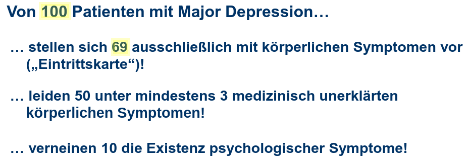

# Anamnese

## Ziele #card 
 
- Beziehungsaufbau  
- Verdachtsdiagnose
^1700862543377

## Prinzip
 
- am Anfang: offene Fragen → Präzisierung
	- warum heute hier?
 
>[!important]
>keine Suggestivfragen!

## Ablauf #card 
 
**AMVVGFSF-Schema**:
1. <u>A</u>ktuelle Anamnese → *falls Schmerz*: OPQRST
2. <u>M</u>edikamentenanamnese
3. <u>V</u>orgeschichte
4. <u>V</u>egetative Anamnese
5. <u>G</u>enussmittelanamnese
6. <u>F</u>amilienanamnese
7. <u>S</u>ozialanamnese
8. <u>F</u>remdanamnese
^1700863037978

>[!warning] Notfall?!
>SAMPLERS-Schema

>[!opinion] die "komische Fragen"-Liste
>- Inspiration: Denkfabrik hat erwähnt, dass er eine Liste an weirden Fragen hat, die er immer fragt, auch wenn sich Leute dann wundern.
>- imo gute Idee, weil bei Anamnese muss man sich bzgl. unnötiger Überdiagnostik / Kriteriumsvalidität keine Sorgen machen
>- man muss die Leute, aber vorwarnen & auf die Schweigepflicht hinweisen
>- meine Liste:
>	- wurden sie von Zecke gebissen
>	- Magen-Darm-Infekt gehabt
>	- suspekten sexuellen Kontakt gehabt
>	- von einem Hund gebissen
>	- Weichkäse aus FR gesnackt
>	- Wildfleisch o. schlecht gegartes Schweinefleisch gegessen
>	- Corona gehabt
>	- Lachgas

>[!clnc] CAVE: psych. Erkr. sind noch immer stigmatisiert
>- müssen explizit erfragt werden
>	- Hallus werden ungerne zugegeben
>- 
>	- Vorschlag psychosomatischer Zusammenhänge wirkt häufig kränkend
>- guter Einstieg: Wie sieht's mit dem Schlaf aus?

### aktuelle Anamnese
%% Nenne die wichtigsten Inhalte der aktuellen Anamnese. %% #card 
 
- **W-Fragen**: Was? Wo? Wie? Seit wann?
^1700895705659

### Medikamentenanamnese

#### Ziel #card 
 
- Erkrankungen (die nicht als solche angesehen werden)
- Nebenwirkungen (Beschwerden durch Medikament?)
- Wechselwirkungen (vermeiden, wenn man interveniert)
^1700896080114

#### Vorgehen

- <u>gezieltes Fragen nach</u>: ==Kontrazeptiva, Schmerzmitteln, Schlaf- u. Beruhigungsmittel, OTC==; *Grund*: ==werden oft nicht als Medikamente angesehen==
^1700896527377

### Vorgeschichte

#### Inhalte #card 
 
- Vorerkrankungen
- Vor-OPs
^1700895896074

#### Vorgehen #card 
 
- schematisch Organsystem durchgehen
^1700895896088

>[!warning] Nicht vergessen!
>==Allergien/Unverträglichkeiten== erfragen → Bedenke insb.: ==Medikamente (z.B. Penicillin)==
^1700895896099

### vegetative Anamnese

#### Inhalte #card 
 
- Gewichtsabnahme
- Hunger/Durst
- Wasserlassen/Stuhlgang → Farbe?
- Schlafprobleme
- B-Symptomatik
^1700896931817

### Genussmittelanamnese

#### Inhalte #card 
 
- Alkohol → *wichtig*: Menge!
- Nikotin → pack years
- andere Drogen
^1700897404434

### Familienanamnese

#### Inhalte #card 
 
Erkrankungen/Todesursachen der Angehörigen erfassen (→ Risikofaktoren/hereditär?)
^1700897928990

### Sozialanamnese

#### Inhalte #card 
  
- soziale Situation & häusliches Umfeld, Hobbies, Bildung/Beruf
	- *Grund*: 
		- mgl. Auslöser <abbr title="Schwermetalle, Pestizide etc.">💬</abbr> 
		- Entlassung <abbr title="Kommt Pat. zu Hause zurecht?; Mensch auf Straße zu entlassen nicht obv. wholesome.">💬</abbr> 
		- Berufserkr. = Leistungen
- "Könnte Schwangerschaft bestehen?"
^1700898077683

parent: [clinical skills](clinical-skills.html)
citations: 
[^1]: @LeitfadenInnereUKurs
