# Das **Clinical Reasoning** Dashboard

## Meine Workflow

1. **clinical method** n. A&V: AKU → Lokalisation → Syndrom
2. **strukturierte Differentialdiagnose**:
	- a) DDx des jeweiligen Syndroms auswendig kennen o. nachschlagen
	- b) [leitsymptom_template](leitsymptom-template.html) als Hilfsmittel in der Ausbildungsphase, als Rückfallebene bei komplexen Fällen ("Team-Timeout" w/ Flipchart/Whiteboard) o. als didaktisches Tool
3. **Ranking** der DDx nach individueller Vortestwahrscheinlichkeit
4. sinnvolle **apparative Diagnostik** auswählen

>[!info]- Variante für Innere
> 1. Identifikation der Leitsymptome
> 2. DD zu den Leitsymptomen gem. [TANTE PIAV](dxcompass.html) 
> 3. Top 3 "Ranking" erstellen, welche dieser Verdachtsdiagnosen am <abbr title="z.B. bei welchen der DD kommen mehrere der Leitsymptome vor">wahrscheinlichsten</abbr> sind, u.a. anhand <abbr title="Alter- + Geschlecht Population">base-rate</abbr> 
> 4. zu jeder dieser Verdachtsdiagnosen indizierte Diagnostik-Batterie überlegen 
> 5. Befunde interpretieren → Ranking updaten
> <small>(repeat bis so viele DD ausgeschlossen, dass nur 1 übrig bleibt)</small> 

>[!opinion]
>Wie man aus diesem Workflow erkennt, ist eine gute Anamnese und körperliche Untersuchung die absolute Basis für alles!

>[!funfact]- 
>- häufigste Person, die in Neurologie-Bewerbungen erwähnt wird ist Sherlock Holmes
>	- Charakter basiert auf einem Arzt: Joseph Bell
>		- Doyle hat selbst Medizin studiert und war von seinem Lehrer fasziniert. (s. Abraham Vergheses TED-Talk)

## Toolbox

- Pro-/Contra-Analyse <abbr title="Was spricht dafür vs. was spricht gegen die Diagnose?">💬</abbr> 

>[!link] meine "Tools"
>- wenn ich für den Anfang noch Papier dafür brauch: So be it!! → dann druck ich mir für jeden Pat. ein selbsterstelltes "Formular" aus:
>	- strukturierte_differentialdiagnose
>		- auch hilfreich für: strukturierte Übergabe 
>- zum Nachschlagen:
>	- [DxCompass](dxcompass.html)
>	- Casus

---

## Wege, um zu einer Diagnose zu kommen

- abh. vom Erfahrungslevel:
	- Checklist-Approach bspw. w/ [surgical sieves](https://en.wikipedia.org/wiki/Surgical_sieve) z.B. [TANTE PIAV](leitsymptom-template.html)  
	- Mischformen: Syndrom recognizen → innerhalb dieser Schublade checklist-artig Differentialdiagnose ("Syndromatologie")
	- Pattern Recognition (in Zeitdruck Ausweichmethode)
		- Extremform: Blickdiagnose
- aber auch als erfahrener Gamer sollte man breit denken, um nix zu übersehen, insb. bei schwierigen Fällen: Problem-Listen (= Liste mit Symptomen & für jedes Symptom eine TANTEPIAV) erstellen

### fachspezifische Workflows

- neuroskills > Arbeitsweise: Wie funktioniert Neurologie? The clinical method  
- Psychiatrie > Diagnostik  

## sinnvolle Diagnostik machen

- Anamnese → KU → Apparativ/Labor, s. #fachspezifische Workflows 
- man sollte ein gutes Verständnis für Testtheorie > Meinung (s. auch children) haben
	- als ÄrztIn macht man ja den ganzen Tag Befunde & Diagnostik
	- hilfreiches Werkzeug für den Alltag: LR
- hilfreich: Epidemiologie (Häufiges ist häufig, Seltenes ist selten)
- Der Arztberuf: Grundverständnis für Pathophysiologie & Wissenschaftstheorie/Statistik → selber denken können, keine "Fließbandmedizin"

---

## Ressourcensammlung

- [EU-Initiative & Online-Curriculum](https://did-act.eu/integration-guide/) 
- **Podcasts** 
	- [Clinical Problem Solvers](https://clinicalproblemsolving.com/) 
	- [Denkfabrik Medizin](https://denkfabrikmedizin.de/)
- **Paper**
	- @ClinicalReasoningCorner2020 
- **Bücher**
	- McGee Physical Diagnosis
	- [Neurology Clinical Reasoning Book](https://www.neurology.org/resident-fellow/clinical-reasoning-book) 

parent: Der Arztberuf, [clinical skills](clinical-skills.html)  
children:
- Heuristiken in der medizinischen Diagnostik 
tags: 