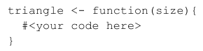
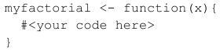

# Data Analysis with R - Assignment 2 - Refresher

<blockquote class="callout callout-link" markdown="1">
<strong class="callout-title">Lösungswege vom ersten Durchlauf:</strong>

- dannyr_assignment02.r 

</blockquote>

- [ ] code von Rstudio hier rein plss #todo 

## 1) control structures

### 1a) Generate a random uniform value (between 0 and 1) using the runif() function and store this value in a variable with the name ‘unknown’.

```r
unknown <- runif(1, min=0, max=1)
```

### 1b) Use an if statement and use the cat() or print() function to print out either: lower or higher if the variable is smaller then 0.5 or bigger than 0.5

```r
if(unknown<0.5) {
  cat("lower than 0.5")
} else {
  cat("higher than 0.5")
}
```

### 1c) Generate a uniform value between -10 and 30, round() it to 0 digits behind the comma, and using an if statement check if the value you generated is between 0 and 10 (inclusive), if the variable is not in this range throw a stop error.

```r
unknown2 <- runif(1, min=-10, max=30) 
if(unknown2>30 || unknown2<0) stop("the value is out of range, gamer")
```

## loops

### 2a) Using a for loop and sum up all the numbers from 1 to 1000 (inclusive), you can check if your answer is correct by comparing the result to the result of sum(1:1000)

```r
#| label: 73475cb4
#for(x in 1:1000){
#  sum <- 0
#  sum = sum + x
#}
# Reflexion über diesen Code: fast richtig, aber Amateur-Fehler: in jedem Durchlauf des Loops wird sum wieder auf 0 resettet; TLDR: sum außerhalb der loop definieren
sum <- 0
for(x in 1:1000){
  sum = sum + x
}

print(sum)
```

<details class="callout callout-output" markdown="1" open>
<summary>{#output-73475cb4}</summary>

\[1\] 500500


</details>

### 2b) Do the same thing as in assignment 2a, but now use a while loop

```r
#| label: da4ea2a5
x <- 0
sum <- 0
while(x < 1000){
x <- x + 1
sum <- sum + x
}

print(sum)
```

<details class="callout callout-output" markdown="1" open>
<summary>{#output-da4ea2a5}</summary>

Error: nicht\-numerisches Argument für binären Operator
function \(..., na.rm = FALSE\)  .Primitive\("sum"\)


</details>

## 3) Create a for loop that does the following a 100 times:

* Generate a random number between 0 and 100 and store it in a variable
* Using a if/else if/else statement check if the variable is lower/higher or equal to 42
* Using the cat() function print one of these three statements, (replace X by the random number generated), make sure you add a newline to the cat statement:
  “X is lower than 42”, “X is higher then 42” or “42 is the answer to life the universe and everything”


<details class="callout callout-output" markdown="1" open>
<summary>{#output-da4ea2a5}</summary>

Error: nicht\-numerisches Argument für binären Operator
function \(..., na.rm = FALSE\)  .Primitive\("sum"\)


</details>

<details class="callout callout-output" markdown="1" open>
<summary>{#output-da4ea2a5}</summary>

\[1\] 500500


</details>

## 3) Create a for loop that does the following a 100 times:

* Generate a random number between 0 and 100 and store it in a variable
* Using a if/else if/else statement check if the variable is lower/higher or equal to 42
* Using the cat() function print one of these three statements, (replace X by the random number generated), make sure you add a newline to the cat statement:
  “X is lower than 42”, “X is higher then 42” or “42 is the answer to life the universe and everything”

```r
#| label: 434c9b5a
meaning_finder <- function(){
	meaning_of_life <- 0
	for(count in 1:100){
		meaning_of_life = round(runif(1, min=0, max=100))
		if(meaning_of_life<42){
			cat(meaning_of_life, "is lower than the Meaning of Life\n")
		}
		if(meaning_of_life>42){
			cat(meaning_of_life, "is higher than the Meaning of Life\n")
		}
		if(meaning_of_life==42){
			cat("You found the Meaning of Life (42)!!\n")
			break
		}	
	}
}

meaning_finder() # test if it works
```

<details class="callout callout-output" markdown="1" open>
<summary>{#output-434c9b5a}</summary>

35 is lower than the Meaning of Life
85 is higher than the Meaning of Life
100 is higher than the Meaning of Life
4 is lower than the Meaning of Life
73 is higher than the Meaning of Life
22 is lower than the Meaning of Life
86 is higher than the Meaning of Life
2 is lower than the Meaning of Life
68 is higher than the Meaning of Life
30 is lower than the Meaning of Life
49 is higher than the Meaning of Life
65 is higher than the Meaning of Life
63 is higher than the Meaning of Life
66 is higher than the Meaning of Life
52 is higher than the Meaning of Life
39 is lower than the Meaning of Life
70 is higher than the Meaning of Life
39 is lower than the Meaning of Life
75 is higher than the Meaning of Life
14 is lower than the Meaning of Life
7 is lower than the Meaning of Life
98 is higher than the Meaning of Life
70 is higher than the Meaning of Life
6 is lower than the Meaning of Life
38 is lower than the Meaning of Life
93 is higher than the Meaning of Life
66 is higher than the Meaning of Life
87 is higher than the Meaning of Life
89 is higher than the Meaning of Life
34 is lower than the Meaning of Life
43 is higher than the Meaning of Life
61 is higher than the Meaning of Life
23 is lower than the Meaning of Life
49 is higher than the Meaning of Life
84 is higher than the Meaning of Life
61 is higher than the Meaning of Life
63 is higher than the Meaning of Life
19 is lower than the Meaning of Life
16 is lower than the Meaning of Life
38 is lower than the Meaning of Life
63 is higher than the Meaning of Life
11 is lower than the Meaning of Life
27 is lower than the Meaning of Life
54 is higher than the Meaning of Life
You found the Meaning of Life \(42\)\!\!


</details>

### 4) Use a while or a for loop and the cat() function to print out a triangle of #, having 12 lines, each line should have one more hashtage then the previous line:

```
#
##
###
####
...
############
```

Make sure that there are NO spaces between the hashtags, and that there is NO additional
whitespace (called trailing white space) before the end of the line.
Tip: Use ``\n`` for going to the next line

```r
#| label: 284de502
for(line in 1:12){
	cat(rep("#", times=line), sep="", "\n")
}
```

<details class="callout callout-output" markdown="1" open>
<summary>{#output-284de502}</summary>

\#
\#\#
\#\#\#
\#\#\#\#
\#\#\#\#\#
\#\#\#\#\#\#
\#\#\#\#\#\#\#
\#\#\#\#\#\#\#\#
\#\#\#\#\#\#\#\#\#
\#\#\#\#\#\#\#\#\#\#
\#\#\#\#\#\#\#\#\#\#\#
\#\#\#\#\#\#\#\#\#\#\#\#


</details>

## Escaping

### 5) Use character escaping and print the following two sentences literally to a file (test.txt), using the cat() function:

I say: "Escaping stuff is 'great', but \ and / might be a nuisance."
You are correct, but I think the ``\t`` and ``\b`` create more problems then a basic “
Check your results by opening the create test.txt file in notepad++

```r
#| label: 43974ed7
cat("I say: \"Escaping stuff is \'great\', but \ and / might be a nuisance.\"\n You are correct, but I think the \\t and \\b create more problems then a basic “", file="assignment02_output.txt")
getwd() # suche in diesem Ordner nach dem output
```

<details class="callout callout-output" markdown="1" open>
<summary>{#output-43974ed7}</summary>

\[1\] "C:/Users/h\_uys/AppData/Local/Obsidian"


</details>

## Random variables

### 6a) Set your random number generator seed to a number of your choice

```r
#| label: d86580a5
set.seed(69420)
```

### 6b) Using runif() generate a vector containing 15 random numbers, between 0 and 10 and store it in a variable called ‘random1’

```r
#| label: 0e652381
random1 <- runif(15, min=0, max=10)
random1 # test if works
```

<details class="callout callout-output" markdown="1" open>
<summary>{#output-0e652381}</summary>

\[1\] 6.1445652 1.1473249 4.5195286 2.7628748 0.4160348 3.5195187 8.4913559
 \[8\] 9.3093829 2.1033293 1.1851617 7.2866854 1.0530460 2.3302019 6.0077145
\[15\] 9.7356131


</details>

### 6c) Use the round() function to round your random numbers in ‘random1’

```r
#| label: 79bf0868
random1 = round(random1)
random1 # test if works
```

<details class="callout callout-output" markdown="1" open>
<summary>{#output-79bf0868}</summary>

\[1\]  6  1  5  3  0  4  8  9  2  1  7  1  2  6 10


</details>

### 6d) Reset your seed to your number, and generate a single random number using rnorm()

```r
#| label: 766cb53c
set.seed(69420)
rnorm(1)
```

<details class="callout callout-output" markdown="1" open>
<summary>{#output-766cb53c}</summary>

\[1\] 0.2909534


</details>

### 6e) Now repeat steps 0b, and 0c, store the results in variable ‘random2’

```r
#| label: 39bb88f4
random2 <- rnorm(15)
random2 = round(random2)
random2 # test if works
```

<details class="callout callout-output" markdown="1" open>
<summary>{#output-39bb88f4}</summary>

\[1\]  0 \-2  1 \-1  1 \-1  2 \-1  0  1  0  0  1  0  1


</details>

## Functions

### 7) Create a function that returns the result of a coin flip (“Heads”, “Tails”)

```r
#| label: 3a1dfb05
flipcoin <- function() {
	temp <- round(runif(1, min=0, max=1))
	if(temp == 0) {
		cat("you got heads!")
	} else {
		cat("you got tails!")
	}
}

flipcoin() # test if it works
```

<details class="callout callout-output" markdown="1" open>
<summary>{#output-3a1dfb05}</summary>

you got tails\!


</details>

### 8) Re-use the code you created in assignment 4, but now make it a function (called triangle) that prints an triangle of which the size can be specified by the user. The function signature will look something like, here size is the parameter that lets the user specify the number of rows of the triangle:



```r
#| label: 4c15f47a
triangle <- function(size) {
	for(line in 1:12) {
		cat(rep("#", times=line), sep="", "\n")
	}
}

triangle() # test if it works
```

<details class="callout callout-output" markdown="1" open>
<summary>{#output-4c15f47a}</summary>

\#
\#\#
\#\#\#
\#\#\#\#
\#\#\#\#\#
\#\#\#\#\#\#
\#\#\#\#\#\#\#
\#\#\#\#\#\#\#\#
\#\#\#\#\#\#\#\#\#
\#\#\#\#\#\#\#\#\#\#
\#\#\#\#\#\#\#\#\#\#\#
\#\#\#\#\#\#\#\#\#\#\#\#


</details>

### 9) Create a function that calculates the factorial ( 5! = 5 * 4 * 3 * 2 * 1 ) of a given number, the function signature should look like this, here x is the function parameter, that represents/holds the input provided by the user:



**Assignment**: fill in the code to make this a working factorial function.

```r
#| label: 0791963c
myfactorial <- function(input) {
#	factor <- 0 # bedingt unendlichen loop, für Begründung s. "# 1"
	factor <- input - 1
	result <- input
	while(!(factor == 0)) {
# 1		factor = input - 1 # Fehlerreflexion: das hier wäre ein unendlicher loop, da factor nicht immer kleiner wird, sondern wir zählen jede Runde 1 von input (z.B. 5) ab, sodass jede Runde factor = 4 gilt und wir nie auf 0 kommen
		result = result * factor
		factor = factor - 1
	}
	return(result)
}

myfactorial(5) # test if it works
```

<details class="callout callout-output" markdown="1" open>
<summary>{#output-0791963c}</summary>

\[1\] 120


</details>

<hr style="border: none; height: 1px; border-bottom: 1px solid; border-image-slice: 1; border-width: 3px; border-image-source: linear-gradient(to right, transparent, lightsalmon, transparent); margin-top: 20px; margin-bottom: 20px; ">

parent: [LogR](logr.html) 
tags: 