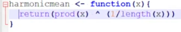

# Data Analysis with R - Descriptive Statistics

>[!link] Dannys Lösungswege
>- ../../ressources/!Code/dannyr_assignment04.r

## 1) Descriptive statistics

During this lecture we’ll be using the iris dataset, which you can load into R by typing:

```r
data(iris)
```

The iris dataset contains 150 measurements of 4 phenotypes on 3 different species of iris flowers.

### 1a) For each phenotype calculate the mean / median and mode per species

```r
# einzelne Spezies (Merkmalsausprägungen) extracten & diese in 3 objects packen

iris_setosa <- subset(iris, Species == "setosa")
iris_versicolor <- subset(iris, Species == "versicolor")
iris_virginica <- subset(iris, Species == "virginica")

# Lagemaße, der neu-generierten datasets bestimmen

## means calculaten

iris_setosa_mean <- apply(iris[,1:4], 2, mean)
iris_versicolor_mean <- apply(iris[,1:4], 2, mean)
iris_virginica_mean <- apply(iris[,1:4], 2, mean)

## median calculaten

iris_setosa_median <- apply(iris[,1:4], 2, median)
iris_versicolor_median <- apply(iris[,1:4], 2, median)
iris_virginica_median <- apply(iris[,1:4], 2, median)

## mode calculaten

### die base "mode" function in R hat nix mit dem "Modus" zu tun, heißt nur zufällig so. Wir müssen eine eigene function für den Modus definieren, da base R keine function dafür hat.

modus <- function(dataset){
  unique_values <- unique(dataset)
  names(which(table(dataset) == max(table(dataset)))) # s. Erklärung in Obsi
}

### neue function anwenden

iris_setosa_modus <- apply(iris[,1:4], 2, modus)
iris_versicolor_modus <- apply(iris[,1:4], 2, modus)
iris_virginica_modus <- apply(iris[,1:4], 2, modus)
```

##### Erklärung zur custom modus-function

- bin nicht drauf gekommen, daher honestly von Danny gesnackt
- basic breakdown:

```markdown
🔍 What happens inside?

Let’s say you call:

modes(c("a", "b", "a", "c", "b", "b"))

Step-by-step:

table(x)
→ Counts how often each unique value appears:

output:
table(c("a", "b", "a", "c", "b", "b"))
# a b c 
# 2 3 1 

max(table(x))
→ Gets the highest frequency (here, 3)

table(x) == max(table(x))
→ Logical check for which values occur that many times:

output:
a FALSE  
b TRUE  
c FALSE

which(...)
→ Returns the index positions of TRUE values (i.e., where the mode is)

names(...)
→ Gets the actual value(s), not the positions
```

### 1b) For each phenotype calculate the overal variation

```r
iris_variation <- var(iris[1:nrow(iris),1:4])
```

>[!tip] random interessante Erkenntnis
>- dies gibt uns jetzt eine "variance-covariance matrix"

### 1c) For each phenotype calculate the variation per species

```r
# step 1: wäre phenotypes zu extracten, haben wir aber schon in 1a) gemacht, daher gehts weiter mit...

# step 2: für jeden phenotype die Varianz berechnen

iris_setosa_variance <- apply(iris[,1:4], 2, var)
iris_versicolor_variance <- apply(iris[,1:4], 2, var)
iris_virginica_variance <- apply(iris[,1:4], 2, var)
```

### 1d) Create a function to calculate the geometric mean; 1e) Create a function to calculate the harmonic mean

```r
data(iris)

# d) Create a function to calculate the geometric mean

geomean <- function(input) {
	return(length(input) / sum(1/input))
}

## test if it works lul

geomean(iris$Sepal.Length)

# e) Create a function to calculate the harmonic mean

harmean <- function(input) {
  product <- 1
  for(count in input) {
    product = product * count
  }
  return(product ^ (1/length(input)))
}

## test if it works lul

harmean(iris$Sepal.Length)
```

zu 1e): man hätte sich die for-loop sparen können mittels integrierter prod-function:


## 2) First plots in R

>[!info]+ Bemerke
>(ab hier Nutzung von Execute Code Plugin, keine persistent variables)

```r
# 2a) Use the histogram function (look up the help file) and for each of the 2 iris species create a histogram for the “Petal.Length” column.

## import dataset
data(iris)

## create variables for every species
iris_setosa <- subset(iris, Species == "setosa")
iris_versicolor <- subset(iris, Species == "versicolor")
iris_virginica <- subset(iris, Species == "virginica")

## create the histograms
iris_setosa_hist <- hist(iris_setosa$Petal.Length)
iris_versicolor_hist <- hist(iris_versicolor$Petal.Length)
iris_virginica_hist <- hist(iris_virginica$Petal.Length)

## test the plots
plot(iris_setosa_hist)
plot(iris_versicolor_hist)
plot(iris_virginica_hist)


# 2b) Use the par() function to change the size of the main title to lettersize 2

## global font size für title ändern
par(cex.main = 2)

## dann irgendeines der plots printen zum testen
plot(iris_setosa_hist)

## zum resetten:
## par(cex.main = 1) 


# 2c) Use the par() and the parameter mfrow to create 3 plots in a single plot window each holding the petal.length of a single species. (make sure each sub-plot has a header with the name of the species)

par(mfrow = c(3,1))

## printen zum testen
plot(iris_setosa_hist)
plot(iris_versicolor_hist)
plot(iris_virginica_hist)

# 2d) Save the plot from 2b to a png file

png("export.png")
par(cex.main = 2)
plot(iris_setosa_hist)
dev.off()
```

### alternativer Lösungsweg

- man kann auch alles in einen plot packen

```r
## import dataset
data(iris)

## create variables for every species
iris_setosa <- subset(iris, Species == "setosa")
iris_versicolor <- subset(iris, Species == "versicolor")
iris_virginica <- subset(iris, Species == "virginica")

## create the histograms
#hist(iris_setosa$Petal.Length, col = "blue")
#hist(iris_versicolor$Petal.Length, add = TRUE, col = "red")
#hist(iris_virginica$Petal.Length, add = TRUE, col = "green")

# Problem: wenn die Daten sehr weit auseinanderliegen, kriegt man nur ein Histogram angezeigt (weil der Rest einfach out of range ist). Daher vorher range festlegen...

plot(x = c(0, 6), y = c(0, 20), t = "n")
hist(iris_setosa[, "Petal.Length"], add = TRUE, col = "blue")
hist(iris_versicolor[, "Petal.Length"], add = TRUE, col = "red")
hist(iris_virginica[, "Petal.Length"], add = TRUE, col = "green")
```

- das macht natürlich nicht immer Sinn, wie z.B. in diesem Fall ists sinnlos

## 3) box plots

```r
## import dataset
data(iris)

## create variables for every species
iris_setosa <- subset(iris, Species == "setosa")
iris_versicolor <- subset(iris, Species == "versicolor")
iris_virginica <- subset(iris, Species == "virginica")

# 3a) Create a single plot showing 3 boxplots next to each other comparing the Sepal.Length between the different species. Use the axis() function to add human readable axis to the plot

boxplot(formula = Sepal.Length ~ Species, data = iris)

### kp, was er mit "human readable axis" meint, finde beide Achsen sehr gut lesbar
```

### Alternativ

- man kann den `## create variables for every species` part skippen

```r
data(iris)

boxplot(formula = iris[, "Sepal.Length"] ~ iris[, "Species"], data = iris)
```

- tbh: basically exakt selber code

### noch eine Alternative

- das ist eine unnötige Alternative, ist aber eine Ausrede dafür, die oben box plots) gelernten Inhalte nochmal zu üben
- Was ist, wenn wir die tilde-function (`~`) noch nicht noch nicht kennen?
- basically müssen wir erst einen leeren plot (bzw. ein Koordinatensystem) erstellen & dann 3 einzelne box-plots jeweils für jede einzelnen Spezies

```r
# import dataset
data(iris)

# create variables for every species
iris_setosa <- subset(iris, Species == "setosa")
iris_versicolor <- subset(iris, Species == "versicolor")
iris_virginica <- subset(iris, Species == "virginica")

# range der Y-Achse bestimmen
yrange <- c(min(iris[, "Sepal.Length"]), 1.15 * max(iris[, "Sepal.Length"])) # warum "1.15"? Weil sonst der Kreis, der den Extremwert repräsentiert, abgeschnitten wird

# Koordinatensystem mit gewünschter Ästhetik erstellen
plot(x = c(0.5, 3.5), y = yrange, xlab = "Species", ylab = "Sepal Length", t = "n", xaxt = "n") # man hätte auch die X-Achse von 0-3 plotten können. Problem: Ein Boxplot hat eine gewisse Breite, dadurch würde der letzte Boxplot aus der Grafik herausragen
boxplot(at = 1, iris_setosa[, "Sepal.Length"], yaxt = "n", add = TRUE)
boxplot(at = 2, iris_versicolor[, "Sepal.Length"], yaxt = "n", add = TRUE)
boxplot(at = 3, iris_virginica[, "Sepal.Length"], yaxt = "n", add = TRUE)
axis(1, at = 1:3, labels = c("Setosa", "Versicolor", "Virginica"))
```

##

<hr style="border: none; height: 1px; border-bottom: 1px solid; border-image-slice: 1; border-width: 3px; border-image-source: linear-gradient(to right, transparent, lightsalmon, transparent); margin-top: 20px; margin-bottom: 20px; ">

parent: [LogR](logr.html)  
tags: 