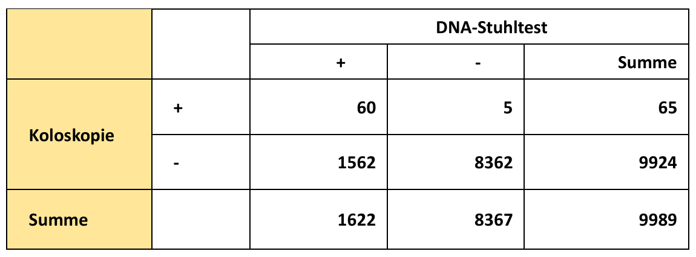

# DIAGNOSTISCHE TESTS & SCREENING

<blockquote class="callout callout-warning" markdown="1">

hab die Aufgabenstellung nicht richtig gelesen & habe so gerechnet als wäre DNA-Test Goldstandard, ohne drüber nachzudenken, aber das is ja nicht schlimm geht ja um drum, dass man die Rechenwege verstanden hat UwU

</blockquote>

## Aufgabe 1

Der Nachweis von Tumor-DNA in Stuhlproben (DNA-Stuhltest) ist ein neuer Ansatz, um die bisher unzureichende Früherkennung von Darmkrebs im Rahmen der Vorsorge zu verbessern. DNA aus kolorektalen Adenomen oder Karzinomen kann anhand typischer Mutationen oder Methylierungsveränderungen im Stuhl nachgewiesen werden. In einer Querschnittstudie von Imperiale et al.1 wurden u.a. für kolorektale Karzinome die diagnostischen Kenngrößen eines DNA-Stuhltest im Vergleich zum Goldstandard (Koloskopie) bestimmt. In der folgenden Abbildung sind Ergebnisse angelehnt an die Studie von Imperiale et al. zusammengefasst:



```r
#| label: 6b51d431
imperiale <- read.csv2("C:\\Users\\crypr\\vaults\\Hüseyins digitales Gehirn\\ressources\\!Datasets\\imperiale.csv", sep = ",", header = TRUE)
imperiale <- data.frame(imperiale)
head(imperiale)
```

<details class="callout callout-output" markdown="1" open>
<summary>{#output-6b51d431}</summary>

Warning: unvollständige letzte Zeile von readTableHeader in 'C:\\Users\\crypr\\vaults\\Hüseyins digitales Gehirn\\ressources\\\!Datasets\\imperiale.csv' gefunden
  coloscopy\_positive1\_negative0 dna\_test\_positive1\_negative0 count
1                             1                            1    60
2                             1                            0     5
3                             0                            1  1562
4                             0                            0  8362


</details>


### 1) Welche Kenngrößen?

Welche Kenngrößen zur Bewertung des diagnostischen Tests können Sie berechnen?
- Sensitivität
- Spezifität

### 2) Berechnung dieser Kenngrößen

Berechnen Sie die beiden diagnotischen Gütekriterien für den DNA-Stuhltest und erläutern Sie kurz, wie Sie zu Ihrem Ergebnis kommen.

#### Sensitivität 

```r
#| label: 3d914f93
count_ill <- sum(imperiale$count[imperiale$dna_test_positive1_negative0 == 1])
count_ill_positive <- sum(imperiale$count[imperiale$dna_test_positive1_negative0 == 1 & imperiale$coloscopy_positive1_negative0 == 1])

sensitivity <- count_ill_positive/count_ill 
print(sensitivity)
```

<details class="callout callout-output" markdown="1" open>
<summary>{#output-3d914f93}</summary>

\[1\] 0.03699137


</details>

#### Spezifität

```r
#| label: 7688b6ef
count_healthy <- sum(imperiale$count[imperiale$dna_test_positive1_negative0 == 0])
count_healthy_negative <- sum(imperiale$count[imperiale$dna_test_positive1_negative0 == 0 & imperiale$coloscopy_positive1_negative0 == 0])

specificity <- count_healthy_negative/count_healthy 
print(specificity)
```

<details class="callout callout-output" markdown="1" open>
<summary>{#output-7688b6ef}</summary>

\[1\] 0.9994024


</details>

## 3) ppv

Eine Person erhält ein positives Testergebnis mit dem DNA-Stuhltest. Wie hoch ist die Wahrscheinlichkeit, dass diese Person tatsächlich ein Kolonkarzinom hat?

```r
#| label: 96061e92
count_positive <- sum(imperiale$count[imperiale$coloscopy_positive1_negative0 == 1])

ppv <- count_ill_positive/count_positive
print(ppv)
```

<details class="callout callout-output" markdown="1" open>
<summary>{#output-96061e92}</summary>

\[1\] 0.9230769


</details>

/ Rest ist nur Wiederholung /

<hr style="border: none; height: 1px; border-bottom: 1px solid; border-image-slice: 1; border-width: 3px; border-image-source: linear-gradient(to right, transparent, lightsalmon, transparent); margin-top: 20px; margin-bottom: 20px; ">

parent: [LogR](logr.html) 
tags: 