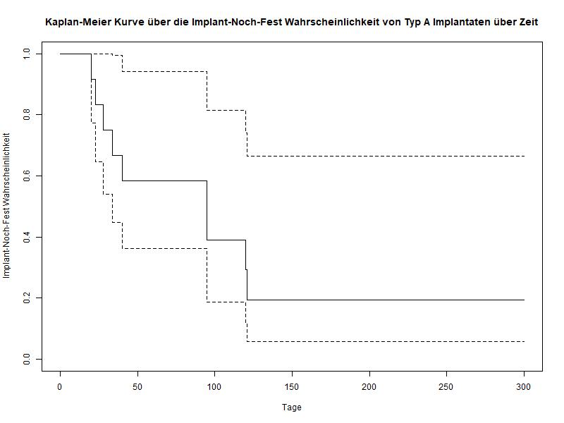
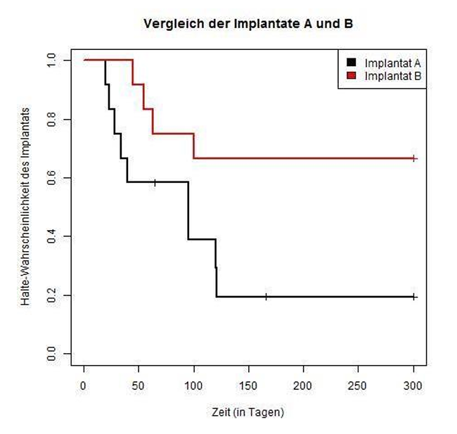
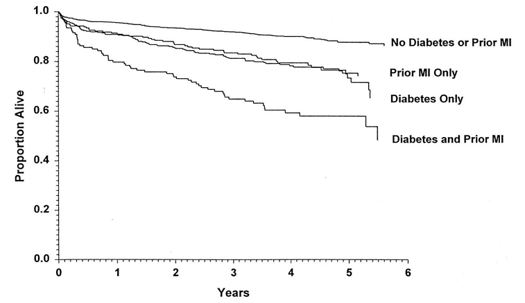
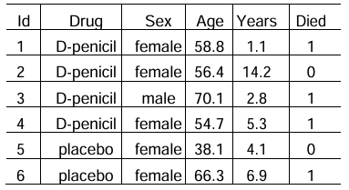
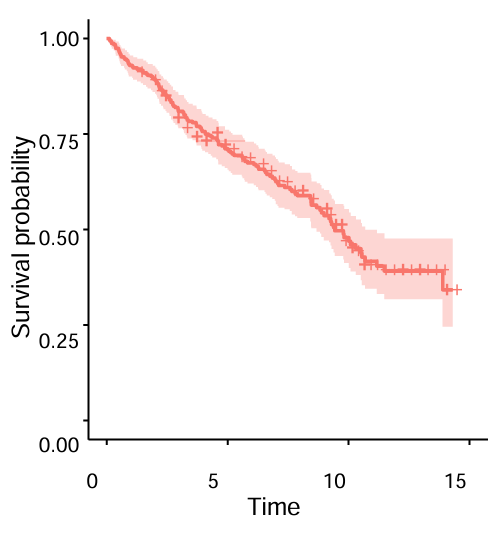
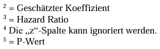
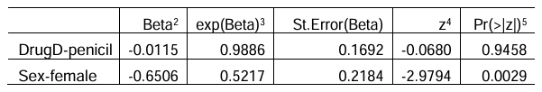
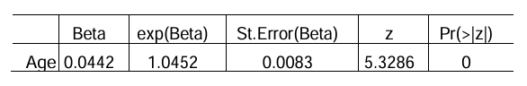

<blockquote class="callout callout-stop" markdown="1">
<strong class="callout-title">Hier sind Fehler!!</strong>

z.B. unter Risiko-Aufgaben
- [ ] korrigieren anhand Lösue #todo 

</blockquote>

## Aufgabenstellung

Nach einer bestimmten Operation am Kiefer ist bei den meisten Patienten das Einsetzen eines Zahnimplantats erforderlich. Dabei stehen zwei verschiedene Typen von Implantaten zurVerfügung (A und B). Es wird eine hohe Wahrscheinlichkeit dafür vermutet, dass sich ein Implantat über die Zeit wieder lockert. Daher soll in einer 1:1 randomisierten Studie an insgesamt **24 Patienten** die Haltedauer beider Implantate über **300 Tage** hinweg beobachtet und miteinander verglichen werden. Die Haltedauer ist definiert als Zeit vom Einsetzen des Implantats bis zum Lockern oder Verlust des Implantats

## Aufgabe 1

Zunächst wird nur das Kollektiv der **12 Patienten mit Implantat vom Typ A** betrachtet: Bei **9 dieser  Probanden lockerte sich das Implantat nach 20, 23, 28, 34, 40, 95, 95, 120, 121 Tagen**; bei **einem Probanden war das Implantat bei der letzten Nachuntersuchung nach 300 Tagen noch fest**, **2 Probanden konnten nur 65 bzw. 166 Tage nachbeobachtet** werden, wobei in dieser Zeit keine  Implantatslockerung bei diesen Probandenauftrat.

### survival-table erstellen in R

```r
#| label: 4523540f
# Paket laden
library(survival)

# object für Ereigniszeiten-erstellen
times <- c(20, 23, 28, 34, 40, 65, 95, 95, 120, 121, 166, 300)

# object für Status erstellen (1 = Ereignis, 0 = Zensur)
states <- c(1, 1, 1, 1, 1, 0, 1, 1, 1, 1, 0, 0)

# Survival-Objekt erstellen # in meinen eigenen Worten: beide objects "zusammenpressen" in ein "survival-object", mit dem das survival package umgehen kann
survival_object <- Surv(times, states)

# Survival-Kaplan-Meier-Modell anpassen
fitted_survival_object <- survfit(survival_object ~ 1) # "~ 1" heißt keine Gruppenvariable einbeziehen in das Modell

# Survival-Tabelle ausgeben
summary(fitted_survival_object)

# und nun das ganze plotten → s. Aufgabe 2
```

<details class="callout callout-output" markdown="1" open>
<summary>{#output-4523540f}</summary>

Call: survfit\(formula = survival\_object ~ 1\)

 time n.risk n.event survival std.err lower 95% CI upper 95% CI
   20     12       1    0.917  0.0798       0.7729        1.000
   23     11       1    0.833  0.1076       0.6470        1.000
   28     10       1    0.750  0.1250       0.5410        1.000
   34      9       1    0.667  0.1361       0.4468        0.995
   40      8       1    0.583  0.1423       0.3616        0.941
   95      6       2    0.389  0.1470       0.1854        0.816
  120      4       1    0.292  0.1387       0.1148        0.741
  121      3       1    0.194  0.1219       0.0569        0.664


</details>

### a) Welche Beobachtungen sind zensiert?

- *3*:
	- Proband, bei dem das Implantat nach 300 Tagen noch fest war.
	- Proband, der nur 65 Tage nachbeobachtet werden konnte, ohne dass das Implantat sich lockerte.
	- Proband, der 166 Tage nachbeobachtet wurde, ohne dass das Implantat sich lockerte.

### b) Wie viele Patienten sind an Tag 96 und an Tag 120 noch „unter Risiko“?

#### Hintergrundgedanken

- ("unter Risiko" = all diejenigen bei denen: Ereignis noch nicht aufgetreten + Beobachtung nicht zensiert)
- **Lösungsansatz**: Entweder aus Tabelle ablesen o. im Kopf zählen

#### Lösung

- Tag 96: ~~6~~ → 4
	- 12 − 7 (Ereignisse) − 1 (Zensierung) = 4
- Tag 120: ~~4~~ → 3
	- 12 − 8 (Ereignisse) − 1 (Zensierung) = 3

<blockquote class="callout callout-opinion" markdown="1">
<strong class="callout-title">Fehlerreflexion</strong>

- ich habe in der Tabelle falsch geguckt, wir betrachten immer die Ereignisse bis kurz vor einem Zeitpunkt ti, ich hätte also eine Zeile weiter unten gucken sollen

</blockquote>

## Aufgabe 2

Die folgende Abbildung zeigt die Kaplan-Meier-Kurve für die Haltedauer in der Patientengruppe mit Implantat A: 

```r
#| label: 44c8031c
plot(fitted_survival_object, xlab = "Tage", ylab = "Implant-Noch-Fest Wahrscheinlichkeit", main = "Kaplan-Meier Kurve über die Implant-Noch-Fest Wahrscheinlichkeit von Typ A Implantaten über Zeit")
```

<details class="callout callout-output" markdown="1" open>
<summary>{#output-44c8031c}</summary>




</details>


### a) Wie hoch ist die geschätzte Wahrscheinlichkeit, dass das Implantat nach 150 Tagen noch festsitzt? 

20%

### b) Wie ist die geschätzte mediane Haltedauer?

abgelesen aus Grafik: 100

### c) Warum fällt die Kaplan-Meier-Kurve nicht auf null ab?

weil nicht alle ein Ereignis haben

## Aufgabe 3

Die folgende Abbildung zeigt nun die Kaplan-Meier-Kurven für die Haltedauer beider Patientengruppen. 



### a) Vergleichen Sie deskriptiv die geschätzte Wahrscheinlichkeit zwischen beiden Gruppen, dass das Implantat nach 90 Tagen noch festsitzt.

Wahrscheinlichkeit bei Implantat B höher

### b) Der p-Wert eines Log-Rank-Tests zum Vergleich der Haltedauer zwischen beiden Gruppen beträgt p = 0.028. Formulieren Sie die Nullhypothese und interpretieren Sie das Testergebnis, wenn man ein Signifikanzniveau von 5% zugrunde legt.

**H0**: Es gibt keinen Unterschied in der U¨berlebenszeit (Haltedauer) zwischen den beiden Gruppen.
**H1**​: Es gibt einen Unterschied in der U¨berlebenszeit (Haltedauer) zwischen den beiden Gruppen.

H0 ablehnen

### c) Wie viele Zensierungen liegen in der Gruppe mit Implantat B vor?

- Zensierungen können wir anhand von Markierungen erkennen, meist "+" → hier: 1 = Person, die bei Ende der Studie immer noch kein Ereignis hatte
- Zensierungen kann man auch daran erkennen, dass beim nächsten Ereignis, der Abfall steiler ist

### d) Wie groß ist die geschätzte mediane Haltedauer von Implantat B?

abgelesen aus Grafik: >300 bzw. nicht bestimmbar
- [ ] grübeln #todo 

## Aufgabe 4

Eine prospektive Kohortenstudie verfolgte das Ziel, den Einfluss von Diabetes auf das Langzeitüber leben nach einem akuten Myokardinfarkt (MI) zu untersuchen, wobei unterschieden wurde, ob es sich um einen Erst-MI handelte oder nicht. Insgesamt wurden **1.935 Patienten** nach akutem Myokar dinfarkt (MI) weiter beobachtet. **13%** dieser Patienten hatten Diabetes aber bisher noch keinen vorherigen MI (Diabetes Only). **20%** der Patienten hatten kein Diabetes, aber bereits schon einmal einen MI (Prior MI Only) und **8%** der Patienten hatten sowohl Diabetes als auch einen vorangegangenen MI (Diabetes and Prior MI). Die folgende Abbildung zeigt die Kaplan-Meier-Kurven für das Überleben in **4 Subgruppen** dieses Patientenkollektivs. (Impact of Diabetes on Long-Term Survival After Acute Myocardial Infarction: Diabetes Care (2001), vol.24, p1422-1427)



### a) Gibt es, rein optisch, in der obigen Grafik Anzeichen dafür, dass die Proportional-Hazards-Annahme nicht gilt?

nah

### b) Wir untersuchen den Einfluss von Diabetes ohne vorherigen Myokardinfarkt, d.h. wir vergleichen die Gruppen No Diabetes or Prior MI1 und Diabetes Only. Anwendung des Log-rank-Tests ergibt einen p-Wert kleiner als 0.001. Wir quantifizieren den Einfluss von Diabetes auf das Gesamtüberleben nach MI mittels Hazard-Ratio. Welche der folgenden Angaben HR (95%-CI) passt dann am besten zu den Auswertungen?

- 2.3 (1.7 – 3.1) # imo richtig
- 2.3 (0.7 – 3.1) # enthält 1
- 0.43 (0.32 – 0.59) # HR < 1: Dies würde bedeuten, dass Diabetes die Hazardrate verringert (schützender Effekt), was unwahrscheinlich ist, da Diabetes typischerweise das Überlebensrisiko erhöht.
- 0.43 (0.32 – 1.59) # enthält 1

#### Lösung

Der Log-Rank-Test ergibt einen **p-Wert < 0.001**:
- Dies deutet auf einen **statistisch signifikanten Unterschied** in der Überlebenszeit zwischen den beiden Gruppen hin.
- Daher muss das Konfidenzintervall der Hazard Ratio diesen Unterschied widerspiegeln und darf **nicht 1 einschließen**. (s. Erinnerung)

##### Erinnerung

Die Hazard Ratio (HR) gibt das Verhältnis der Hazardraten (Risikoraten) zwischen zwei Gruppen an:
- HR > 1: Die Ereignisrate (z. B. Tod) ist in der Vergleichsgruppe (hier: Diabetes Only) höher als in der Referenzgruppe (hier: No Diabetes or Prior MI1).
- HR < 1: Die Ereignisrate ist in der Vergleichsgruppe niedriger.
- HR = 1: Kein Unterschied zwischen den Gruppen.
↳ CI = das Intervall in dem der wahre Wert mit 95% liegt → darf 1 (also "kein Unterschied") nicht einschließen

## Aufgabe 5

In einer kontrollierten randomisierten Studie werden von **312 Patienten**, welche an der sel tenen letalen Autoimmunerkrankung der primären biliären Zirrhose leiden, **158 mit Pencilin** und der Rest mit einem Placebo behandelt. Es soll der Einfluss der Behandlung untersucht werden, während für ein mögliches Confounding durch das Geschlecht kontrolliert wird. Des Weiteren soll der Zusammenhang mit dem Alter untersucht werden. Die folgende Ta belle enthält die ersten 6 Patienten des Datensatzes:



Die folgende Grafik zeigt den entsprechenden Kaplan-Meier-Schätzer aller Patienten:



### a) Es wird zunächst ein Cox-Proportional-Hazard-Modell gefittet, welches die zwei Kovari aten Drug und Sex enthält. Es wird hier davon ausgegangen, dass die Proportional-Ha zard-Annahme erfüllt ist.

<blockquote class="callout callout-legend" markdown="1">



</blockquote>

#### Interpretieren Sie den folgenden Regressionsoutput:



- **Drug (Penicillin)**:
    - **Beta:** -0.0115 → Der geschätzte Effekt der Kovariate "Drug" (Penicillin) ist nahezu null.
    - **exp(Beta):** 0.9886 → Die Hazard Ratio beträgt 0.9886, was nahe bei 1 liegt. Das bedeutet, dass die Verwendung von Penicillin im Vergleich zur Referenzgruppe fast keinen Einfluss auf die Hazardrate hat.
    - **p-Wert (Pr(>|z|)):** 0.9458 → Der Effekt ist statistisch **nicht signifikant** (p > 0.05).
- **Sex (female):**  
    - **Beta:** -0.6506 → Ein negativer Beta-Wert zeigt, dass das weibliche Geschlecht mit einer niedrigeren Hazardrate (geringeres Risiko) im Vergleich zur Referenzgruppe (männlich) assoziiert ist.
    - **exp(Beta):** 0.5217 → Die Hazard Ratio beträgt 0.5217. Frauen haben im Vergleich zu Männern ein um ca. **48% niedrigeres Risiko** (1 - 0.5217 = 0.4783).
    - **p-Wert (Pr(>|z|)):** 0.0029 → Der Effekt ist statistisch **signifikant** (p < 0.05).

#### Wäre es vorstellbar, auf Basis von Kaplan-Meier-Schätzern und Log-Rank-Tests ähnliche Ergebnisse zu erhalten? Wenn ja, wie würden Sie vorgehen? Welche Vorteile würde ein Regressionsmodell dennoch bieten?

- eigtl. ja, weil
	- Kaplan-Meier = Überlebenszeiten bzw. -wahrscheinlichkeiten
	- Log-Rank = Unterschiede zw. Gruppen
- aber Vorteil für Cox: Einfluss von Einflussfaktoren (dafür ists ja da, z.B. Geschlecht, Alter etc.)
	- kann ich versuchen mit Kaplan-Meier/Log-Rank auszugleichen, in dem ich die Gruppe gem. jener "Einflussfaktoren" zu definieren (z.B. männlich, weiblich)

### b) Es wird nun ein Cox-Proportional-Hazard-Modell gefittet, welches die stetige Kovariate Alter enthält. Es wird hier davon ausgegangen, dass die Proportional-Hazard-Annahme erfüllt ist.

#### Interpretieren Sie den folgenden Regressionsoutput:



- **Beta:** 0.0442 → Ein positiver Beta-Wert zeigt, dass das Alter mit einer höheren Hazardrate (höherem Risiko) assoziiert ist.
- **exp(Beta):** 1.0452 → Die Hazard Ratio beträgt 1.0452. Für jedes zusätzliche Lebensjahr steigt die Hazardrate (das Risiko) um ca. **4.5%**.
- **p-Wert (Pr(>|z|)):** 0.0000 → Der Effekt ist statistisch **hochsignifikant** (p < 0.05)

#### Wäre es möglich, ähnliche Ergebnisse auf Basis von Kaplan-Meier-Schätzern und Log-Rank-Tests zu erhalten? Wenn ja, wie würden Sie vorgehen? Welche Prob leme würden mit so einem Vorgehen einhergehen?

- da stetig wie erwähnt in #a|#a|#a|#a Es wird zunächst ein Cox-Proportional-Hazard-Modell gefittet, welches die zwei Kovari aten Drug und Sex enthält. Es wird hier davon ausgegangen, dass die Proportional-Ha zard-Annahme erfüllt ist.) Es wird zunächst ein Cox-Proportional-Hazard-Modell gefittet, welches die zwei Kovari aten Drug und Sex enthält. Es wird hier davon ausgegangen, dass die Proportional-Ha zard-Annahme erfüllt ist.) 
	- wir müssten binnen (jung vs. alt), aber dann Informationsverlust

<hr style="border: none; height: 1px; border-bottom: 1px solid; border-image-slice: 1; border-width: 3px; border-image-source: linear-gradient(to right, transparent, lightsalmon, transparent); margin-top: 20px; margin-bottom: 20px; ">

parent: [LogR](logr.html)
tags: 