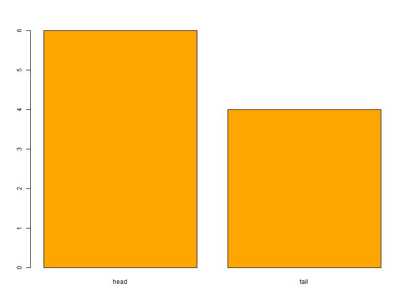

# Schätzunsicherheit / Statistische Tests

## Übung 1 - 1

### Aufgabenstellung

Münzwurf: Wir werfen 10 mal eine Münze und erhalten dabei 6 mal Kopf und 4 mal Zahl. Berechne das 95%-Konfidenzintervall. Nehmen wir an die Münze sei so geprägt, dass sie exakt in der Hälfte der Fälle Kopf anzeigt. Läge dann der wahre Wert im 95%-Konfidenzintervall?

```r
#| label: 6b51d431

# Creating the dataset (wouldnt exist in the real world, since you would be actually importing your research data stored in some csv and refering to your variables there)

coinflip_head1_tail0 <- c(1,1,1,1,1,1,0,0,0,0) 

# barplot

## exists only for coinflip_barplot
coinflip_head_count <- sum(coinflip_head1_tail0)
coinflip_tail_count <- 10-sum(coinflip_head1_tail0)
coinflip_head1_tail0_transformed <- c(coinflip_head_count,coinflip_tail_count)
coinflip_barplot_yaxis <- c("head","tail") 

coinflip_barplot <- barplot(coinflip_head1_tail0_transformed, names.arg=coinflip_barplot_yaxis, col="orange")
```

<details class="callout callout-output" markdown="1" open>
<summary>{#output-6b51d431}</summary>




</details>

### Antwort

#### Lösungsweg 1: per Hand ausrechnen

- **Berechnung des CI für Kopf**
	- Standardabweichung für Kopf: 
	  *SD_Kopf = Wurzel(0,6x0,4) = Wurzel(0,24) = 0,49* 
	- Standardfehler für Kopf:
	  *SE_Kopf = 0,49/3,16 = 0,16*
	- Margin of Error für Kopf:
	  *MoE = 0,16x1,96 = 0,3*
	- <u>demnach CI</u>: *0,6+0,3; 0,6-0,3 → 0,3 bis 0,9*
- außerdem: Wahrscheinlichkeit von Kopf im Falle einer idealen Münze: 𝑝 = 0.5, liegt im 𝐶𝐼

#### Lösungsweg 2: mit R ausrechnen

```r
#| label: 031b4af5
coinflip_trials <- length(coinflip_head1_tail0)
coinflip_test_result <- prop.test(coinflip_head_count,coinflip_trials)
print(coinflip_test_result)
```

<details class="callout callout-output" markdown="1" open>
<summary>{#output-031b4af5}</summary>

1\-sample proportions test with continuity correction

data:  coinflip\_head\_count out of coinflip\_trials, null probability 0.5
X\-squared = 0.1, df = 1, p\-value = 0.7518
alternative hypothesis: true p is not equal to 0.5
95 percent confidence interval:
 0.2736697 0.8630694
sample estimates:
  p 
0.6


</details>

## Übung 1 - 2

### Aufgabenstellung

Wir werfen 10 mal einen Würfel und erhalten dabei die Zahlen 6, 5, 4, 6, 3, 2, 6, 4, 6 und 6. Berechne das 95%-Konfidenzintervall. Nehmen wir an, der Würfel sei nicht gezinkt und zeige jede Zahl exakt mit der gleichen Wahrscheinlichkeit an. Läge dann der wahre Wert im 95%-Konfidenzintervall? // es geht um die mittlere Augenzahl btw

```r
#| label: 48449a14
# create dataset. obviously you wouldnt do this in R but rather load in your dataset
dice <- c(6, 5, 4, 6, 3, 2, 6, 4, 6, 6)

# calculate mean

dice_mean <- mean(dice)
cat(dice_mean)
```

<details class="callout callout-output" markdown="1" open>
<summary>{#output-48449a14}</summary>

4.8


</details>

### Antwort (2 - 2)

#### Lösungsweg 1: per Hand

- Mittelwert: 4,8
- Standardabweichung: 
```r
#| label: 8c1f1046
dice_sd <- sd(dice)
print(dice_sd)
```

<details class="callout callout-output" markdown="1" open>
<summary>{#output-8c1f1046}</summary>

\[1\] 1.47573


</details>

- Standardfehler: 
  *SE = 1,48 / 3,16 = 0,47*
- Margin of Error:
  *MoE = 0,47 x 1,96 = 0,92*
- CI: 4,8 - 0,92 bis 4,8 + 0,92 → *3,88 bis 5,72*
- nein wahrer Mittelwert (3,5) nicht enthalten

#### Lösungsweg 2: in R (2 - 2)

```r
#| label: 37834f2f
dice_test_result <- t.test(dice)
print(dice_test_result)
```

<details class="callout callout-output" markdown="1" open>
<summary>{#output-37834f2f}</summary>

One Sample t\-test

data:  dice
t = 10.286, df = 9, p\-value = 2.829e\-06
alternative hypothesis: true mean is not equal to 0
95 percent confidence interval:
 3.744327 5.855673
sample estimates:
mean of x 
      4.8


</details>

## Übung 2 - 1

Im Rahmen einer Kohortenstudie zur TIA (Transitorische ischämische Attacke) werden über 5 Jahre Patienten beobachtet, die zu Beginn der Studie noch keine TIA erlitten haben. Es werden folgende mögliche Risikofaktoren erhoben: Geschlecht, Alter, Adipositas und Rauchen. Welche der untenstehenden Ergebnisse sind statistisch signifikant bei einem Signifikanzniveau von 5%?

### Aufgabenstellung

Männer haben ein um 0.1 höheres Risiko als Frauen. Das 95% Konfidenzintervall für die Risikodifferenz ist [−0.04; 0.24]

### Antwort

Nope, 0 ist enthalten

### Aufgabenstellung

Patienten, die während der Studie eine TIA erleiden, sind im Schnitt 5.5 Jahre älter. Der dazu durchgeführte t-Test ergibt 𝑇 = 2.01.

### Antwort

jap, weil extremer als 1,96 (o. -1,96)


## Übung 2 - 2

### Aufgabenstellung

Das Odds Ratio für den Risikofaktor Adipositas beträgt 1.5. Das zugehörige 95%-Konfidenzintervall ist 1.23; 1.83

### Antwort

ja ist signifikant, da 1 nicht enthalten

### Aufgabenstellung

Raucher haben ein um 0.3 erhöhtes Risiko. Der zugehörige p-Wert liegt bei 0.005.

### Antwort

ja signifikant, da < 0.05

<hr style="border: none; height: 1px; border-bottom: 1px solid; border-image-slice: 1; border-width: 3px; border-image-source: linear-gradient(to right, transparent, lightsalmon, transparent); margin-top: 20px; margin-bottom: 20px; ">

parent: [LogR](logr.html)
tags: 