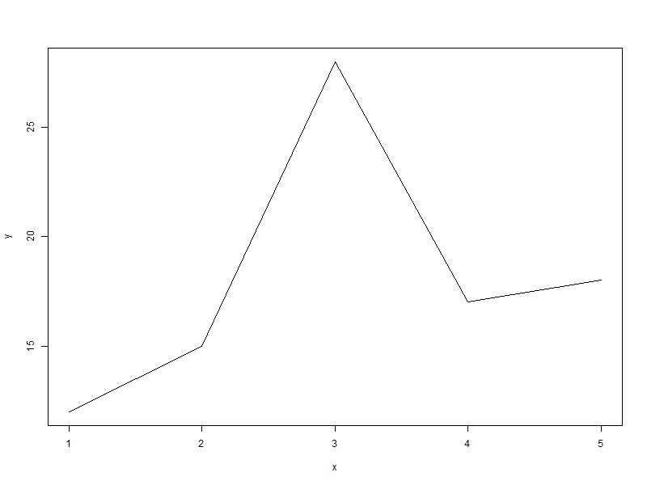
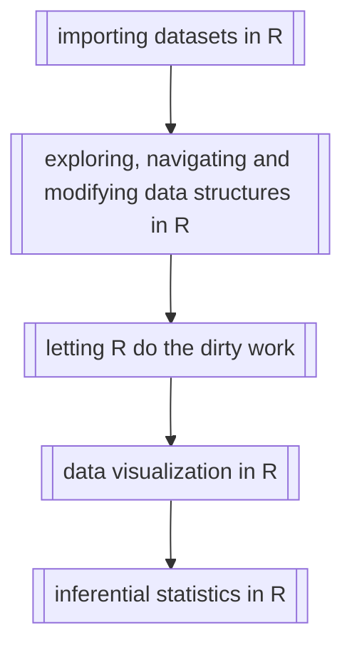
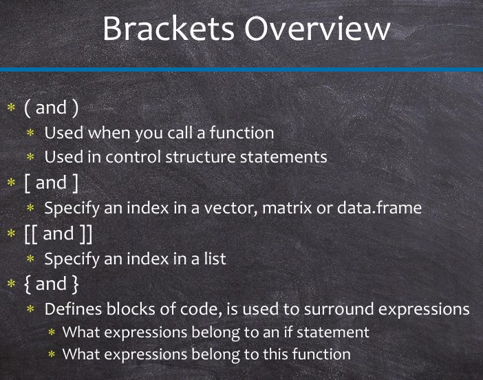
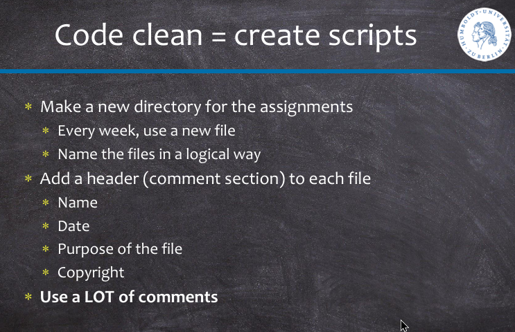
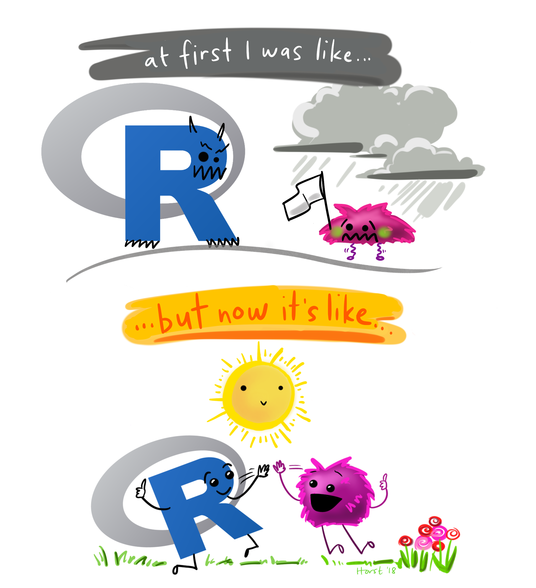

# R

<blockquote class="callout callout-link" markdown="1">
<strong class="callout-title">#SYNAPSE</strong>

s. how to use R for stඞtistics  

</blockquote>

<details class="callout callout-hammer" markdown="1" open>
<summary>collection of resources</summary>

- bereits geschriebene Codes: [LogR](logr.html) (Hausaufgaben-Sammlung)
- ❤️ favorites:
	- [swirl package](https://swirlstats.com/) (bester Startpunkt!)
	- (1): [Danny Arends' lecture series](https://www.youtube.com/playlist?list=PLhR2Go-lh6X4fCAa3c_TBAjZD5A25s7fo)  
	- (2): [R-Kursbuch](https://amd-lab.github.io/R-Kurs-Buch/) (Mainz)
- https://r-graph-gallery.com (!)
- https://rdrr.io/ 
- [videos](https://www.youtube.com/playlist?list=PLyrgSsXBvy1Ix3-j8L7kMkP71aeQQljJg) 
- https://posit.co/resources/cheatsheets/ 
- https://bookdown.org/ 
- https://projecteuler.net/ - Unmengen an Assignments!
- @giorgiLanguageEngineBioinformatics2022 - tolles Paper, das einem einen Überblick über alle Säulen von R gibt
- [R-Otter](https://meikesteinhilber.github.io/otter/) (von Mainz & Frankfurt) 
- plugins
	- qmd as md
	- Quarto exporter

</details>
^e6e511

## instඞllඞtion

<a href="https://drive.google.com/open?id=18olSya3CUKLRDBDiSvgHXy8SaaeF9VZh&usp=drive_fs" class="mybutton1">Download R</a>

<a href="https://drive.google.com/open?id=18o4pvn_4J7tN5j6n4yH0w4G5QJrtf4GX&usp=drive_fs" class="mybutton1">Download RStudio</a>

```r
#| label: 4ec9599f
y = c(12, 15, 28, 17, 18)
x = 1:length(y)
plot(x, y, type="l")
```

<details class="callout callout-output" markdown="1">
<summary>{#output-4ec9599f}</summary>




</details>

## unterstඞnding R

in seiner simpelsten Anwendungsweise ist R ein Taschenrechner (s. calculations in R)

```R
a <- 5+7
```

aber *on Steroids*: s. Wie funktioniert R? 

### Wie funktioniert R?

- im Prinzip definieren wir Schubladen (= *objects*)
- in diese Schubladen können wir alles reinstecken: Zahlen, Text (in "Gänsefüschen"), Tabellenspalten (*datasets*), sogar andere Schubladen
	- dieses "Reinstecken" machen wir mit Hilfe des "assignment operator": *<-*
- nun benutzen wir *functions*, um mit diesen *objects* herumzuspielen  

```R
Schublade1 <- "Baum"
print(Schublade1)
```

wir können auch synonyme *objects* definieren:
```R
Schublade1 <- Schublade2 <- Schublade3 <- "Baum"
print(Schublade2)
```
<small>Schublade1, Schublade2 und Schublade3 produzieren alle "Baum"</small> 

<blockquote class="callout callout-quote" markdown="1">
<strong class="callout-title">John Chambers, the creator of R</strong>

To understand computations in R, two slogans are helpful: 1. Everything that exists is an object. 2. Everything that happens is a function call.

</blockquote>

<blockquote class="callout callout-connection" markdown="1">
<strong class="callout-title">Let's get deeper down the rabbit hole</strong>

👉 the physiology of R - variables and control structures

</blockquote>

## how to use R for stඞtistics

### Prinzip

1. create a dataset!
2. do some calculations
3. visualize the data
4. make inferences 

### Workflow #SYNAPSE 

- im Folgenden möchte ich eine Übersicht über die wichtigsten MOCs erstellen, um einen "roten Faden" zu haben
- es empfiehlt sich diesen Workflow mit einem brainstorming zu beginnen z.B. in Excalidraw, dass die einzelnen komputationellen Schritte darstellt
	- dann sollte man sich überlegen: wie kann ich diese Logik in Code übersetzen
		- & dann kann man folgende MOCs nutzen um einen Überblick über die verschiedenen Tools zu bekommen, um das umzusetzen:



<blockquote class="callout callout-tip" markdown="1">
<strong class="callout-title">&quot;Mathematiker sind faul.&quot;</strong>

nicht von 0 anfangen → Skripte, die man schonmal erstellt hat, wiederverwenden:
- [LogR](logr.html) 
- [schmeRzhub](http://100.116.21.74:8888/files/Workspaces/schmerzhub/v2/index.html?_xsrf=2|dd37d6e4|4379a2af19b4b61da61eaa2ddc2d15e9|1766325485) 

</blockquote>

## Was macht R als Programmiersprache besonders?
↳ R - eine besondere Programmiersprache  

<blockquote class="callout callout-connection" markdown="1">
<strong class="callout-title">siehe auch</strong>

👉 the guts of R

</blockquote>

## ein Guide

### hilfreiche functions für den Start

- install package function in R 
- library function in R 
- ls function in R 
- args function in R 
- query functions in R 
- rm() um objects zu löschen

R functions > Umgang mit functions

### weirde Sachen zum Beachten

- Die Anzahl der Variablen, die man haben kann, ist limitiert anhand RAM.
	- `object <- 100000000000000000000000000000000000000` funktioniert nicht lol

### die "Vokabeln" von R

- "()" → beim Callen von functions
- "subsetting in R"
- "#" → *commenting*, Sehr hilfreich, so viel wie möglich!


(screenshot from [^1])

### Tipp-Sammlung

- am Ende wird man gefragt, ob man den Workspace speichern möchte. Das sollte man nicht machen, denn wenn man das macht, wird dieser Workspace beim nächsten Start automatisch geladen. Es kann sein, dass man das nicht will, z.B. wenn die Datei mehrere Gigabyte groß ist, sodass es mehrere Minuten laden muss. Stattdessen lieber manuell mit Save Function speichern und laden.
- Help is available ! → intensiv nutzen!

```r
?functionname # Open the help file for function
  Jede Funktion hat eine Help-Page, sogar, "+".
??term # Search for a term across 
?seq # Open the help for the seq function 
??WORT # Search anything containing "WORT" in R
```

- <- & = haben identische Bedeutung
	- ein empfehlenswerter, aber nicht obligatorischer Tipp: beim erstmaligen Definieren einer Variable "<-" verwenden, beim updaten dieser Variable "=" verwenden
- außerdem gibts den pipe operator  
- parallel immer R functions beim coden anhaben, da ich am Anfang noch nicht die functions kenne & Inspiration brauche
- **useful shortcuts**:
	- Alt+Shift+K → Spickzettel über alle Shortcuts
	- Ctrl+L → console clearen
	- Ctrl+Enter → selektierten Code in Konsole schmeißen & ausführen
	- Ctrl+Shift+P → öffnet command paletteQuick
- bei Problemen: debuggen mit ChatGPT (sehr hilfreich, aber zuerst so gut es geht selbst coden!)
- so viel *commenten* wie möglich (s.o.)
	- nested commenting: mit Anzahl von # kommuniziere ich eine Hierarchie wie Header in Markdown
	- inline commenting: differenziere ich von o.g. d

### best practices 

- jedes R Projekt sollte am besten 3 Ordner haben
	- 1x "input data"
		- hier kommen die (teilweise tausende € teure) Daten rein. → daher: read-only einstellen!
	- 1x "output data"
	- 1x code
- man sollte keinen Code direkt in der Konsole schreiben, sondern in einem Editor wie Notepad++ oder den inkludierten Editor in RStudio, dann in die Konsole einfügen bzw. in RStudio kann man mit Ctrl+Enter die jeweilige Selektion ausführen (obviously, das ist schließlich der Sinn von Programmieren)
	- für Menschen mit Programmier-Phobie: https://rkward.kde.org/screenshots/ (basically ein GUI-Frontend inspiriert an SPSS, die im Hintergrund R-Code ausführt)
- viel-sagende Variablen- & Funktionsnamen ausdenken, z.B. statt zum hundertsten mal "x" zu nutzen "user_input"
- nach jedem laden eines datasets mit ``head`` Funktion überprüfen!!!
- <u>für jedes Projekt</u>: Dashboard erstellen mit Quarto 
- packages, um RStudio als one stop for all statistics zu nutzen 


(screenshot from [^1])
↳ s. R_template.r 

---


(cartoon from [^2])

<hr style="border: none; height: 1px; border-bottom: 1px solid; border-image-slice: 1; border-width: 3px; border-image-source: linear-gradient(to right, transparent, lightsalmon, transparent); margin-top: 20px; margin-bottom: 20px; ">

parent: Programmiersprachen
citations: 
[^1]: Danny Arends: "Data Analysis in R", available at https://www.youtube.com/playlist?list=PLhR2Go-lh6X4fCAa3c_TBAjZD5A25s7fo 
[^2]: 