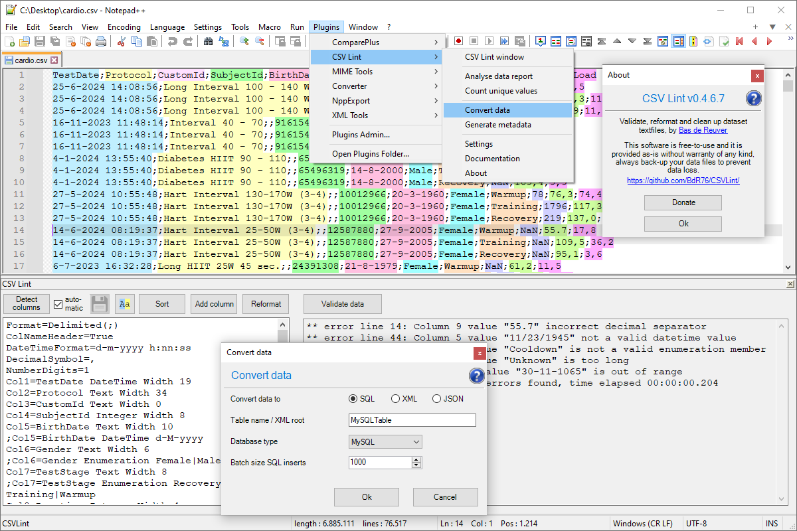

# statistical software 

## Übersicht

- R 👑

>[!quote]- GUIs für R
>- Vergleich: @GraphicalUserInterface2019
>	- bestes UI: RKWard & Jamovi
>	- Nachteile von Jamovi: nutzt custom R functions ihres Jamovi R packages
>	- Vorteile von Jamovi: integrierter CSV-Editor, integriert gut mit R
>	- Vorteile von RKWard & Rcmdr: nutzen nur base R
>	- RKWard vs. Rcmdr:
>		- RKWard hat mehr Optionen für Deskriptiva
>		- Rcmdr hat (deutlich) mehr Optionen für Inferenzstatistik; bereits gewohnte Umgebung ("lebt" in RStudio, daher u.a. kombinierbar mit anderen addins, die ich schon nutze & mag)
>	- Nachteil von Rcmdr: läuft nicht auf RStudio Server!

---

- Excel
- jamovi
- SPSS
- PSPP ඞ
- JASP (https://jasp-stats.org → ""für Bayesianische Statistik"")
- GraphPad
- gpower
- dagitty

## Prinzipien

- reproducability in science: Grundkonzept!
- Open Science → Open Source: im Sinne der Transparenz ist es sinnvoll, wenn bekannt ist, wie eine Statistik Software im backend funktioniert

## mein Workflow #SYNAPSE 

>[!warning] alle genutzten Tools (inkl. Packages) müssen zitiert werden!

1. 3 Ordner anglegen mit folgender Hierarchie (inspiriert von Danny Arendts)
	- PROJEKT_NAME
		- bin_files: alle nicht-R-Dateien also z.B. Word-Dokumente
		- r_workspace
			- import: CSV-files, die von R gelesen werden sollen
				- dürfen nicht von R direkt modifiziert werden!
					- daher schreibgeschützt
			- export: für Grafiken, Tabellen
2. Datengewinnung: Jamovis Spreadsheet Feature

>[!info]- Alternativen
> - Linux: Kate (integrated in RKWard)
> - Windows: Notepad++ mit CSVLint (bzw. jeder andere Text Editor)
> 
> - regelmäßige backups!!
> - wenn unbedingt sheet-editor nötig, mit möglichst wenig Automatisierung:
> 	- DataEditR (direkt in Rstudio!)
> 	- Comma Chameleon von Open Data Institute
> 	- https://www.visidata.org/ 
> 	- Gnumeric
> 	- https://sourceforge.net/projects/recsveditor/ 
> 	- LibreOffice Calc (bei import konfigurieren, damit kein auto-transform)

3. Projekt in RStudio erstellen
4. HTML-Homepage mit Quarto erstellen mit Kontext; local links & Erklärungen zu allen wichtigen files
	- mermaid für data flow / pipelines
	- "flow-package" für Visualisierung der code-logik
5. grobe Statistik mit Jamovi machen
6. überarbeiten mit Qwen Coder Next & alten Skripten
7. beim eintragen von Fragebogen-Daten eine Art tabellarisches "Tagebuch" führen, in dem ich für jeden Patienten kommentiere, ob mir irgendetwas komisch vorkam z.B. ob etwas unleserlich war & dann wie und warum ich mich entschieden habe

## "Regeln"

- es ist sinnvoll sich eine handvoll Regeln auszudenken, wie man mit bestimmten Situationen umgeht, damit man am Ende nicht verwirrt ist
	- fehlende Werte = "-" (bisher wars immer "")
		- das ist so sinnvoller, denn es macht einen Unterschied, ob Daten fehlen o. vergessen einzutragen
	- DEZIMAL NIE MIT KOMMA SONDERN IMMER MIT PUNKT TRENNEN

### Variablen-Benennung

>[!tip] TLDR
> - Schema "TEST_ITEM_KATEGORIEN"
> 	- den Kategorien Zahlen zuordnen
> 	- alles kleingeschrieben! ansonsten viel zu prävalente Fehlerquelle, da einige Software case sensitive und andere nicht, kjann man schnell mal vergessen

bei der Benennung von Variablen müssen einige Bedingungen erfüllt sein, damit die Statistik-Programme damit umgehen können:

| Regel | Details / Beispiel |
|---|---|
| Bedingungen für Variablennamen | Optimale Länge: bis 8 Zeichen |
| | Beginnen mit einem Buchstaben |
| | Außer Buchstaben nur die Ziffern 0 bis 9 und `_` |
| | Keine Leerzeichen, Umlaute, Sonderzeichen ( + - * / , . : ! ? % # ) |
| Einprägsame Namen wählen | `id`, `geschl`, `geb_dat`, `unt_dat` |
| Variablenlabels setzen | Patienten-ID, Geschlecht, Geburtsdatum, Untersuchungsdatum |
| Messniveau definieren | Skala / Ordinal / Nominal |
| Stetige (= quantitative) Variablen: Originalwerte verwenden | z. B. Alter nicht in Klassen einteilen, sondern in Jahren eingeben; Altersklassen in SPSS berechnen |
| Keine abgeleiteten Variablen eingeben, sondern in SPSS berechnen! | Alter aus Geburtsdatum und Studienbeginn; Body-Mass-Index aus Gewicht und Größe; Einteilung in Kategorien Unter-/Normal-/Übergewicht aus BMI |
| Numerische Variablen: Zahlen (0, …, 9) | Nachkommastellen mit Komma (nicht Punkt!) abtrennen; Fehlende Werte: Blank oder z. B. Zahlenwert 99999; Für negative Werte einfach Minuszeichen (-) vorstellen |
| Datumsangaben: TT.MM.JJJJ (15.04.1987) | Erspart Ärger bei Datentransformation von Excel in SPSS! |
| Kategoriale (= nominale, ordinale) Variablen müssen verschlüsselt werden | z. B. Geschlecht: 1 = männlich / 2 = weiblich |
| Kodierung kategorialer Variablen: vollständige Liste der möglichen Ausprägungen erstellen | Je zwei Ausprägungen müssen sich gegenseitig ausschließen |
| Ordinale Struktur (Reihenfolge) soll bei Verschlüsselung erhalten bleiben | Ausdauertraining: 0 = nein / 1 = gelegentlich / 2 = regelmäßig |
| Für gleiche Ausprägungen unterschiedlicher Variablen gleiche Codes verwenden | z. B. immer: 0 = nein / 1 = ja |
| Jeden Variablennamen nur einmal verwenden! | – |
| Kommt eine Variable mehrfach vor (z. B. bei Längsschnittstudien), Variablennamen fortlaufende Zahlen anhängen | `gewicht_0`, `gewicht_1`, `gewicht_2`, … |
| In jede Zelle nur ein Variablenwert! | – |
| Sind für eine Variable mehrere Angaben möglich (z. B. mehrere Vorkrankungen), mehrere binäre Variablen verwenden | `vorekr_1`, `vorekr_2`, … (Ausprägung: ja/nein); `Diabetes_vor`, `Hypertonie_vor`, … |
| Alle Variablen immer kleingeschrieben | – |
| Falls Codierung oder Berechnungen: hinter `_` | z. B. `dice_mean` oder `coinflip_head1_tail0` |

---
parent: Biostatistik, Bioinformatik